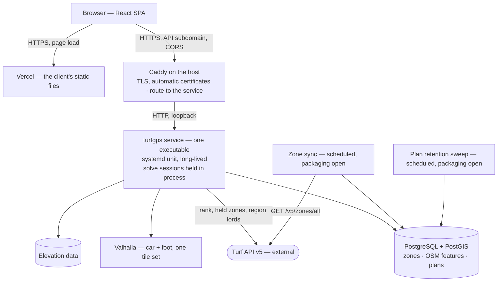

# Deployment

How TurfGPS should operate with as little complexity as possible.

This document owns *how the system is run* — the runtime target, the host it runs on, where its deployment configuration lives, and the operational duties that follow from the architecture. It does not restate an architectural decision or a model: those are stated once, in `Architecture.md` and `CalculationSpecification.md`, and copying one breaks the anti-duplication rule the documentation set depends on.

Citations in this file take the code span, per `docs/README.md § Conventions`, which decides the class by a property rather than by exclusion: a working document is **consulted rather than read through**, so a citation in it has to be findable by `grep`. This document is used that way, and that section's enumeration names it.

**The deployment model is written; the rest of this document is not.** The model was authored on 14 August 2026, and it discharges the item `Architecture.md § Still owed by this document` handed here, and nothing more. `§ The tile build` was added to it later, for #263, and discharges the tile-identity item `Architecture.md § What is not decided` hands here. Hosting options with price and complexity comparisons, pipeline and CI detail, and the wider operational direction that `docs/README.md § The documents` asks of this file are listed under `§ Still owed by this document`.

**Nothing described here has been deployed, and none of the configuration named below exists on disk.** The repository holds `service/`; it holds no `web/` and no `deploy/` as this is written, 22 August 2026. This document is a design, in the same sense `Architecture.md` is one — it is read as *what the deployment will be*, not as a record of a running system. **That date is this document's only as-of date**: everything it states about what is true now rather than what it specifies is measured then, and no other paragraph carries one.

---

## The deployment model

### The runtime target

**The TurfGPS service is deployed onto a single Linux host, where it runs as one long-lived process supervised by systemd.**

The process is started once, at boot or on deploy, and serves every request for the lifetime of that process. It is not started per request, per connection, or per invocation.

**This is forced rather than preferred, and three separate places force it.** `Architecture.md § D1` rules out any serverless deployment target regardless of language, because the candidate set, access classifications and computed costs must survive the initial solve. `docs/Requirements/runtime-and-deployment-shape.md § NFR-004` states the same exclusion as a `MUST`, admitting no target that ends the process between requests. And `Architecture.md § Runtime topology` records that the service is stateful and long-lived, that solve sessions live inside it, and that this document must account for that.

**The model accounts for it by not scaling out at all.** `Architecture.md § Runtime topology` states the constraint precisely: this is not a scale-out-behind-a-load-balancer design *without deliberate session affinity*. The first release therefore runs **one instance of the service on one host**, which is the only arrangement under which the constraint cannot be violated, and it is also the least complex. Two instances behind a round-robin proxy would send a user's second request to a process holding none of their solve state — a failure that returns a plausible answer computed from scratch, so it surfaces as latency rather than as an error. Session affinity is the price of a second instance, and nothing in the first release requires one.

**Supervision is systemd, and the choice is nearly forced too.** The unit is what makes the process long-lived across a crash and across a reboot, and it is the artefact an inspector reads to confirm that. No orchestrator is introduced: a single stateful process with no scale-out story has nothing for one to schedule.

**The choice is reversible, and what a substitute must provide is the test.** Another supervisor, or a container runtime with a restart policy, is admissible if it gives the same three properties — surviving the request, surviving a crash, surviving a reboot — and the same single-instance story. Nothing above depends on a feature peculiar to systemd.

**The three properties are not the whole test, and a container runtime is where the remainder bites.** The controls this model carries are written against a host that `deploy/provisioning/` constrains and a proxy that fronts it: the exposure invariant of `§ What is deployed` and the plan-code log constraint of `§ Where the deployment configuration lives`, both below. **A container runtime inherits neither for free.** Publishing a port hands the service the network directly, and `§ What is deployed` records why that is worse here than it looks — the runtime's port mapping would be the only thing standing between the service and the internet. Container logging likewise collects the process's standard streams by default, which is where the service's log goes, so the service half of that log constraint lands on the runtime's collector rather than on anything a proxy directive can reach. **A substitute is admissible only if it enforces both controls itself**, and nothing in this model enforces them on its behalf.

**What the host must carry for the service to start is deliberately not decided here.** `§ What this document does not decide` says why, and `deploy/provisioning/` below is the seam it will be written into.

### Where the deployment configuration lives

**`deploy/`, at the repository root, as a peer of `service/`, `web/`, `docs/` and `.claude/`.**

This follows the reasoning of `Architecture.md § D8` rather than inventing a second layout convention: that decision put each deployable in its own directory and declined a module at the root, on the argument that the repository's structure is what a reader infers first. The configuration that *arranges the host* is not part of the service's Go module and not part of the client's build; it is a third thing, and it takes a peer directory for the same reason the other two do.

**Two deployment files already sit inside `service/`, and they locate that boundary rather than breach it.** `service/Dockerfile` and `service/.dockerignore` exist on disk and are deployment configuration on any ordinary reading. They stay where they are because they describe **how the service is built into an image** — its build context is `service/` precisely so the image needs nothing from outside the module — and a deployable's build inputs are its own business. What `deploy/` owns is the other half: **what runs on the host and how it is arranged there.** The line is between building a deployable and placing one, not between directories, and the two files above fall on the build side of it. **`deploy/` is still where the host arrangement lives.**

**The directory does not exist yet, this document does not create it, and no item on the board authors it.** `docs/Requirements/DECISIONS.md § RD-009` ruled that #25 inspects the deployment configuration and authors none of it, and recorded the authoring node as a debt with its home named rather than filing one — read there what that debt waits on. What this model specifies for the directory is:

| Artefact | What it establishes |
|---|---|
| `deploy/turfgps.service` | The service's systemd unit — a long-lived process, restarted on failure, never per request. **This is the file `docs/Requirements/runtime-and-deployment-shape.md § NFR-004`'s second criterion is satisfied against.** |
| `deploy/proxy/` | The Caddy configuration — TLS termination on certificates Caddy obtains and renews itself, the route to the service on the API's own subdomain, and the proxy's share of the two plan-code constraints below: the caller-address constraint whole, and the proxy half of the log constraint |
| `deploy/provisioning/` | What must be true of the host before the first apply — the seam `§ What this document does not decide` leaves open, and the exposure invariant of `§ What is deployed` |
| `deploy/README.md` | Apply order |

The zone sync and the plan retention sweep under `§ Operational duties` need units of their own **only if they are packaged separately from the service**, which `§ Open questions owned by this document` records as undecided for both. Neither bears on the criterion above.

**The unit file is the artefact and the target is what it names.** `docs/Requirements/runtime-and-deployment-shape.md § NFR-004`'s criterion asks that the deployment configuration name a target keeping the process running between requests; a systemd service unit answers that on its face, in a form a reviewer can inspect without running anything. That is the whole reason the criterion was written against an artefact rather than against a claim.

**No secret material of any kind lives under `deploy/`, or anywhere else in this repository.** A database URL, a provider key, or the proxy's TLS private key written into an `Environment=` line is a credential committed to version control, and the unit above is precisely the file that invites one. **The unit therefore references an out-of-repo source** — systemd offers `EnvironmentFile=` and `LoadCredential=` for exactly this — and `deploy/` carries the reference and never the value. Which of those mechanisms is used, and where the material comes from, is still owed and is listed under `§ Still owed by this document`; the boundary above is not, and it binds whatever answer that work gives.

**Two constraints exist because of the plan code, and `deploy/proxy/` carries the caller-address one whole and only the proxy's half of the other.** `Architecture.md § Personal data` records that the code is a plan's only credential and that the object behind it holds a coordinate that is frequently the user's home.

**No host log may record a plan code — not the proxy's, not the service's.** The code travels in the request line, and stock nginx and Apache log the full request target by default. **Caddy, the proxy `docs/adr/ADR-0006-deployment-topology.md` chose, differs in a way that is easy to misread as safety.** It writes no access log until a `log` directive enables one ([`log` directive](https://caddyserver.com/docs/caddyfile/directives/log); [`app.go:243`](https://github.com/caddyserver/caddy/blob/v2.11.7/modules/caddyhttp/app.go#L243) at v2.11.7), and an enabled one records the request's `uri` ([How Logging Works § Structured logs](https://caddyserver.com/docs/logging#structured-logs)), so an access log, if `deploy/proxy/` enables one, must not record the request target. Its HTTP error logger is always on, though: a request that fails with a status of 500 or above — the `502` it returns when the service is down is one — is logged at `ERROR` with the request, `uri` included, to Caddy's default log on standard error, with no `log` directive anywhere ([`server.go:652`](https://github.com/caddyserver/caddy/blob/v2.11.7/modules/caddyhttp/server.go#L652), [`server.go:773`](https://github.com/caddyserver/caddy/blob/v2.11.7/modules/caddyhttp/server.go#L773), [`reverseproxy.go:1675`](https://github.com/caddyserver/caddy/blob/v2.11.7/modules/caddyhttp/reverseproxy/reverseproxy.go#L1675), [`logging.go:45`](https://github.com/caddyserver/caddy/blob/v2.11.7/logging.go#L45)). A log is not something a deployment adds; it is something a deployment must deliberately constrain, so deferring observability to `Architecture.md § Still owed by this document` does not defer this. The proxy configuration must satisfy the proxy's half on its face, against the error log as well as the access log.

**The other half has a different home, and `deploy/` is not it.** The service writes its own log through `log/slog` from its own source and installs no handler, so it goes to standard error — which the systemd unit above collects into the journal, a host log in exactly the sense the constraint above means. No file under `deploy/` can constrain what it records: a proxy directive reaches the proxy's access log and nothing else. The service's half of this constraint therefore binds whoever writes those log statements in `service/`, and it is stated here because this is where the constraint is derived rather than where it is discharged. One control, two enforcement points; a deployment that satisfies only the proxy's has satisfied half of it.

**The proxy must preserve the caller's address.** It forwards over loopback, so unless it passes the caller through, every request reaches the service from the local interface and no per-caller distinction survives the hop. `Architecture.md § Personal data` names rate limiting on the plan lookup as part of the answer to a short code being an enumeration target, and no throttle can be written against a single indistinguishable caller. That makes the proxy a **candidate enforcement point** for that throttle — it is the one component that still knows who is asking — though where it is enforced is not settled here.

### What is deployed

Five units, deployed independently — four on one host, and the client on Vercel:

| Unit | Built from | Deployed as |
|---|---|---|
| The service | `service/` | One executable plus one systemd unit |
| The client | `web/` | A directory of static files, deployed on Vercel rather than on the host |
| The reverse proxy | — | Caddy, configured from `deploy/proxy/` |
| The data plane | — | PostgreSQL with PostGIS, and Valhalla with its tiles, per `Architecture.md § D4` and `Architecture.md § D3` |
| The elevation surface | — | Elevation data, held wherever `Architecture.md § D6` settles it — that decision is open, and this document does not anticipate it |

**The proxy is counted even though nothing in this repository builds it**, because three of the five rows share that property and deploying it is a deliberate act with configuration of its own. What decides a row is whether the unit has to be put in place and kept correct there, not whether a build produces it.

**The tile set and the elevation data are built once for the first release and are not refreshed on a schedule.** The tile set derives from the extract of `Architecture.md § D5`. **The elevation data does not derive from it** — the extract decides only which footprint of the elevation surface is held, and where that surface comes from is what `Architecture.md § D6` is still open on. Rebuilding either is a deliberate act — new extract, rebuild, swap — rather than a timer, and for the tile set that act also loads the access-marking tables, under `§ The tile build` below. OSM data ages, so a tile refresh eventually becomes a recurring duty with a cadence and a swap procedure; **that argument reaches the tile set alone**, because the elevation surface is not OSM-derived and does not age with OSM — what would trigger a re-sample there is a new release of that surface or a change of footprint. **This document names both duties and invents neither cadence**, for the same reason `§ Sizing` states no figure.

**The client is deployed independently of the service, and that independence is a requirement rather than a convenience.** `docs/Requirements/runtime-and-deployment-shape.md § NFR-005` obliges the client to be built to files a static file host can serve with no application code executing on the server, and its `Rationale` names this document as what would otherwise have to reconstruct that separation. **The client is deployed on Vercel, per `docs/adr/ADR-0006-deployment-topology.md`, and that deployment is the built files alone**: no Vercel function, serverless or edge, may be part of it, so no application code executes to serve the client. Publishing a new client is a Vercel deployment; it needs no service restart, and a service deploy needs no client rebuild.

**The browser calls the service directly, on the API's own subdomain, under CORS — never through a Vercel rewrite.** A rewrite would carry every API request line, plan codes included, through a platform whose logs nothing in this repository configures: the log constraint of `§ Where the deployment configuration lives`, breached off the host where no directive reaches. The API's subdomain resolves to the host, and its requests reach the service through Caddy like any other. Whether Caddy or the service sets the CORS headers, and which origins they admit, is the artefacts' to settle. **The same constraint reaches the client's own addresses.** `Architecture.md § Persistence and cross-device transfer` lets the code be given as a link, and a link to the client is a request to Vercel, so a plan code may never sit in its path or query. A link that carries one carries it in the fragment, which the user agent separates from the URI before the request is made ([RFC 3986 § 3.5](https://www.rfc-editor.org/rfc/rfc3986#section-3.5)). That binds whoever designs the link, and it is stated here because this is where the constraint is derived.

**The reverse proxy is the only component that may face the network, and that is an obligation rather than an observation.** It terminates TLS and forwards the service's HTTP API over the loopback interface, and it listens on ports 80 and 443, which Caddy's certificate issuance needs reachable from outside ([Automatic HTTPS § Overview](https://caddyserver.com/docs/automatic-https#overview)). **The service, PostgreSQL and Valhalla must therefore bind loopback only, so that nothing but the proxy is reachable from outside the host.** This is written as an obligation the deployment owes rather than as a property it has, because the gap below is real today and a reader who took it for a description would provision against a host that is not the one they have.

**`deploy/provisioning/` owns enforcing that invariant**, because no component enforces it on the others' behalf and one of the three violates it if left alone. Valhalla's HTTP daemon does not bind loopback on its own, so an unconstrained host publishes a routing engine — and through it the tile set — to the internet.

**The service is not a violator: it binds loopback unless it is told otherwise, and only an explicit setting tells it otherwise (#125).** `service/cmd/turfgps/main.go` listens on `127.0.0.1:8080` by default, and `TURFGPS_LISTEN_ADDR`, read by `service/internal/config`, is the one input that changes it. An empty host or a wildcard address there binds every interface, so widening is a value an operator writes rather than one they inherit; a malformed value, or a host name in place of an IP address, is refused and the service does not start. **The service therefore holds its share of the invariant by itself, and `deploy/provisioning/` verifies that share rather than enforcing it.** It must still verify it, because the variable reaches the service from the unit's out-of-repo environment source (`§ Where the deployment configuration lives`), which nothing in this repository can read. A widened bind would answer on **both address families and on every provider-internal or VPC network the host sits on**, and a packet filter around it is a second thing to keep correct that fails open when it is merely incomplete — an operator who writes a correct IPv4 rule and never its IPv6 counterpart has misapplied nothing, and the service still answers. **The container image is the one artefact in this repository that sets the variable**, to every interface of the container, because a published port never reaches a container's loopback; `service/Dockerfile` says why, and on that substitute runtime what faces the host is the runtime's publish address.

The invariant is therefore checked against the host's listening sockets, which is a fact about the host, rather than inferred from the proxy's configuration, which is a fact about only one component.

#### The tile build

**The tile set and the access-marking tables are two derivations of one `.osm.pbf` file, made in one act.** `Architecture.md § Loading from the extract the tiles are built from` requires it and hands the act here: the tiles are built by `valhalla_build_tiles`, the tables are loaded by `turfgps load-access-markings -extract FILE`, both from that file, and the tile build records the file's SHA-256 beside the tiles. This section fixes the order of the steps, what the host holds when one fails, where the SHA-256 is recorded and how the service reads it. Every Valhalla property it relies on is cited to Valhalla's source or documentation at 3.9.1, the version CI pins (`.github/workflows/gates.yml`, `VALHALLA_IMAGE`); a deployment of another version re-reads each citation first.

**The act, in order.** Each step starts only once the one before it has succeeded.

1. **Fix the file.** The `.osm.pbf` file is copied once, into a directory of the act's own. The SHA-256 is computed from the copy, not from its source, the copy is renamed to that SHA-256 as 64 lower-case hexadecimal digits followed by `.osm.pbf`, and its write permission is removed. That path is the **act's file**, and it is the only file the act reads from here on: the act derives it here and passes it to steps 2 and 3, and no later step is given a path by hand. From the SHA-256 comes the **tile stamp**: the SHA-256's first 16 hexadecimal digits, read as an unsigned 64-bit integer. A file whose stamp is zero cannot be served, because the engine omits a zero stamp from what it reports ([`serializers.cc:120`](https://github.com/valhalla/valhalla/blob/3.9.1/src/tyr/serializers.cc#L120)).
2. **Build the tiles, beside the served ones.** `valhalla_build_tiles` reads the act's file, as its only input file and from its first stage, under a build configuration whose `mjolnir.dataset_id` is the tile stamp and whose `mjolnir.tile_dir` is a fresh directory no engine reads, and `valhalla_build_extract` packs the tile files, as they are ([`valhalla_build_extract:103`](https://github.com/valhalla/valhalla/blob/3.9.1/scripts/valhalla_build_extract#L103)), into a new tar file on the filesystem holding the served one, at a path of its own. Nothing the running engine reads is touched. The build is never resumed with `--start` past `initialize`: only that stage purges the tile directory ([`util.cc:671`](https://github.com/valhalla/valhalla/blob/3.9.1/src/mjolnir/util.cc#L671)), so a resumed build would build on what an earlier run left there, from whatever file that run read.
3. **Load the tables.** `turfgps load-access-markings -extract FILE`, with the act's file as `FILE`. On success its `osm_extract_load` row is `current` and carries the file's SHA-256.
4. **Check, then swap and restart.** The act's file is hashed again, and its SHA-256 must equal step 1's and the `current` load's; if either differs, nothing is swapped, the new tar is deleted and the act starts again from step 1. The engine is stopped. The new tar is renamed over the served one, the record below is written to a temporary file beside it and renamed over the served record, and the engine is started.

**The tiles are built before the tables are loaded, so that the step that refuses content cannot strand the host.** `Architecture.md § Loading from the extract the tiles are built from` has the load fail on a feature it cannot draw, and an extract cut through one fails it. A load after the swap would fail onto new tiles and old tables, which would disagree until a new file was cut and built. Ordered this way, the host holds after each failure:

| Fails at | The host holds |
|---|---|
| Steps 1 and 2 | Everything as before the act: the previous tiles served, the previous load `current`, or none. A new tar, if one was written, is deleted |
| Step 3 | The same. The loader leaves the previous load `current`, or none (`Architecture.md § Loading from the extract the tiles are built from`); the new tar is deleted, never swapped |
| Step 4, or between steps 3 and 4 | New tables and, served or not, tiles whose identity is not theirs: the previous tiles until the restart, or no answer from the engine. Finishing step 4 brings the two into agreement; re-running the act on the previous file brings back the previous state. A check at step 4 that fails leaves the previous tiles served |

From the moment step 3 commits until the engine is serving the new tar, the identity read below is the previous tiles', or none, and it differs from the `current` load's. **That window is an outage, not a hazard**, and its length is the length of step 4 — or, where the check at step 4 fails, until the act is run again.

**Where the SHA-256 is recorded.** In two places, and the service reads both:

- **In the tiles, as the tile stamp.** `valhalla_build_tiles` writes `mjolnir.dataset_id` into the header of every tile it builds ([`graphbuilder.cc:630`](https://github.com/valhalla/valhalla/blob/3.9.1/src/mjolnir/graphbuilder.cc#L630), from the `mjolnir` section, [line 1485](https://github.com/valhalla/valhalla/blob/3.9.1/src/mjolnir/graphbuilder.cc#L1485)); the hierarchy's tiles copy it from the tile they derive from ([`hierarchybuilder.cc:271`](https://github.com/valhalla/valhalla/blob/3.9.1/src/mjolnir/hierarchybuilder.cc#L271)). Valhalla documents it as an operator's integer, "a release number, a build counter, an epoch etc." ([`change-identification.md`](https://github.com/valhalla/valhalla/blob/3.9.1/docs/docs/concepts/change-identification.md), § `dataset_id`). It is 64 bits wide ([`graphtileheader.h:660`](https://github.com/valhalla/valhalla/blob/3.9.1/valhalla/baldr/graphtileheader.h#L660)), so the tiles can carry a quarter of the SHA-256 and no more, and the configuration's integer reaches them whole: `valhalla_build_tiles` parses its configuration with rapidjson ([`argparse_utils.h:54`](https://github.com/valhalla/valhalla/blob/3.9.1/src/argparse_utils.h#L54); [`config.cc:22`](https://github.com/valhalla/valhalla/blob/3.9.1/src/config.cc#L22)), which keeps a 64-bit integer exact ([`rapidjson_utils.h:195`](https://github.com/valhalla/valhalla/blob/3.9.1/valhalla/baldr/rapidjson_utils.h#L195)).
- **Beside the tiles, as the tile record.** One file next to the served tar, holding the file's SHA-256 as 64 lower-case hexadecimal digits and a newline, and nothing else. It carries the whole SHA-256, which is what the planner compares with the `current` load's.

**How the service reads it.** Each time `Architecture.md § Loading from the extract the tiles are built from` has the planner read the tile set's identity, the service:

1. asks the engine its routing goes through, at `TURFGPS_VALHALLA_URL`, for `/status` with `"verbose": true`, and reads `osm_changeset`, "the tileset's `dataset_id` field" ([`status.md`](https://github.com/valhalla/valhalla/blob/3.9.1/docs/docs/api/status.md), line 22), as an unsigned 64-bit integer — the engine writes it as one ([`serializers.cc:122`](https://github.com/valhalla/valhalla/blob/3.9.1/src/tyr/serializers.cc#L122)), and it is never carried through a floating-point number;
2. reads the tile record at `TURFGPS_TILE_IDENTITY_FILE`;
3. takes the record's SHA-256 as the tile set's identity **only where its first 16 hexadecimal digits are `osm_changeset`**.

Anything else yields no identity. An engine that does not answer, or a `/status` without `osm_changeset`, leaves it **missing**; a record that is absent or holds anything but the 64 digits and a newline leaves it **unreadable**; a record whose stamp is not the engine's is **stale**, a SHA-256 not read from the tiles the running engine serves. Those are the three cases `Architecture.md § Loading from the extract the tiles are built from` names as unknown, and what an unknown identity, or one that differs from the `current` load's, does to planning is that section's, not this document's. The service holds no copy of the stamp or the record between reads.

**Why the value read is the identity of the tiles the running engine serves.** `osm_changeset` is not a file on disk but a field of a tile the engine holds: the verbose status reads it from the header of a tile its own reader returns ([`status_action.cc:59`](https://github.com/valhalla/valhalla/blob/3.9.1/src/loki/status_action.cc#L59) and [line 75](https://github.com/valhalla/valhalla/blob/3.9.1/src/loki/status_action.cc#L75)). With `mjolnir.tile_extract` set, every tile that reader returns comes from the tar ([`graphreader.cc:594`](https://github.com/valhalla/valhalla/blob/3.9.1/src/baldr/graphreader.cc#L594)), and the tar is memory-mapped whole when the reader is constructed ([`graphreader.cc:89`](https://github.com/valhalla/valhalla/blob/3.9.1/src/baldr/graphreader.cc#L89); [`sequence.h:748`](https://github.com/valhalla/valhalla/blob/3.9.1/valhalla/midgard/sequence.h#L748)), which `valhalla_service` does once per worker, as each worker thread starts ([`valhalla_service.cc:226`](https://github.com/valhalla/valhalla/blob/3.9.1/src/valhalla_service.cc#L226); [`loki/worker.cc:295`](https://github.com/valhalla/valhalla/blob/3.9.1/src/loki/worker.cc#L295), [`thor/worker.cc:69`](https://github.com/valhalla/valhalla/blob/3.9.1/src/thor/worker.cc#L69)). The engine therefore serves, for its whole lifetime, the tar its path named when it started, and reports that tar's stamp.

**Neither case `Architecture.md § Loading from the extract the tiles are built from` names as unknown can be read as a match:**

- **Tiles reloaded under a running engine.** A tar renamed over the served path while the engine runs is never read by it: the engine keeps the file it mapped, which a mapping holds open after its path is reused ([POSIX `mmap`](https://pubs.opengroup.org/onlinepubs/9799919799/functions/mmap.html), the extra reference; [POSIX `rename`](https://pubs.opengroup.org/onlinepubs/9799919799/functions/rename.html)). It keeps reporting the previous stamp, so a record written for the new tar does not match it. **This is why the engine's `tileset_last_modified` is not the identity**: it is the modification time of whatever the path names at the moment of the request ([`status_action.cc:24`](https://github.com/valhalla/valhalla/blob/3.9.1/src/loki/status_action.cc#L24)), so it follows the new tar while the engine serves the old one.
- **A record left beside the tiles from the last build.** A record is read only where its stamp is the engine's, and a record from another build carries another build's stamp.

**Three obligations keep that argument true**, and each failure they guard against would otherwise read as a match:

- **The served tar is never written in place.** It is mapped shared ([`sequence.h:184`](https://github.com/valhalla/valhalla/blob/3.9.1/valhalla/midgard/sequence.h#L184)), so bytes written into the file the engine mapped change the tiles under it while its stamp stays put. It is only ever replaced by renaming a new file over it, as step 4 does.
- **The serving configuration names `mjolnir.tile_extract`, and names neither `mjolnir.tile_dir` nor `mjolnir.tile_url`.** Where the tar yields no tiles, the reader falls back to `tile_dir` ([`graphreader.cc:485`](https://github.com/valhalla/valhalla/blob/3.9.1/src/baldr/graphreader.cc#L485)) and reads each tile from it when a request first needs it ([line 630](https://github.com/valhalla/valhalla/blob/3.9.1/src/baldr/graphreader.cc#L630)), or fetches it from `tile_url` ([line 652](https://github.com/valhalla/valhalla/blob/3.9.1/src/baldr/graphreader.cc#L652)): tiles read after the engine started, while the status keeps the stamp of the first tile it read for the life of the process ([`status_action.cc:59`](https://github.com/valhalla/valhalla/blob/3.9.1/src/loki/status_action.cc#L59), a `static`). With neither named, a tar that yields no tiles leaves the engine with none ([`graphtile.cc:105`](https://github.com/valhalla/valhalla/blob/3.9.1/src/baldr/graphtile.cc#L105)), and its status carries no `osm_changeset`. The build configuration of step 2 is therefore a separate file from the serving one.
- **Nothing starts the engine while step 4 renames.** Each worker maps the tar as it starts, so an engine starting across a rename could hold two tars at once, reporting one and routing on the other. Step 4 stops the engine before it renames and starts it after; under systemd, a unit stopped by `systemctl stop` is not restarted by its `Restart=` policy ([`systemd.service`](https://www.freedesktop.org/software/systemd/man/latest/systemd.service.html), `Restart=`).

**The serving configuration also sets `service_limits.status.allow_verbose` to `true`.** It defaults to false ([`valhalla_build_config:371`](https://github.com/valhalla/valhalla/blob/3.9.1/scripts/valhalla_build_config#L371); [`loki/worker.cc:432`](https://github.com/valhalla/valhalla/blob/3.9.1/src/loki/worker.cc#L432)), and without it the status returns before `osm_changeset` ([`status_action.cc:55`](https://github.com/valhalla/valhalla/blob/3.9.1/src/loki/status_action.cc#L55)), which yields no identity. Valhalla warns that the verbose status "can be computationally expensive" ([`status.md`](https://github.com/valhalla/valhalla/blob/3.9.1/docs/docs/api/status.md), line 7), and what two calls per journey cost over the extract of `Architecture.md § D5` is unmeasured. The engine must bind loopback only (`§ What is deployed`), so what the verbose status reveals reaches nothing outside the host while that invariant holds.

**The tile stamp is a label the build is handed, not a hash of what `valhalla_build_tiles` read.** It copies `mjolnir.dataset_id` into each tile whatever its input file was ([`graphbuilder.cc:630`](https://github.com/valhalla/valhalla/blob/3.9.1/src/mjolnir/graphbuilder.cc#L630)); only the loader hashes what it reads. A match between record and engine therefore proves that the served tiles carry the stamp of the file the tables were loaded from, not that they were built from it. What binds the build's input to that file is the act's file: one path, fixed at step 1 and named by its SHA-256, the only path steps 2 and 3 are given, and re-hashed at step 4 against step 1's SHA-256 and the `current` load's. **One residual remains: step 2 run by hand on another file under the act's build configuration.** Nothing in the tiles records which file they were built from, so those tiles read as a match. What guards it is the act alone — it derives the path once and no step takes one from its operator — so a tile build outside the act is outside this argument.

**Beyond that, the binding between record and engine is 64 bits wide.** Two different files whose SHA-256 agree in their first 16 digits are a pair it cannot tell apart: a record for either would be read as the identity of tiles built from the other. Every other way of getting the stamp wrong — a stamp miscopied into the build configuration, a record written for a build that was never swapped — yields no identity rather than a false one.

**What this section names, and where each comes from:**

| Setting | Where it is set | Its value, and its origin |
|---|---|---|
| `mjolnir.dataset_id` | The build configuration of step 2 | The tile stamp, from step 1 |
| `mjolnir.tile_extract` | The serving configuration | The served tar's path, which step 4 renames over |
| `mjolnir.tile_dir`, `mjolnir.tile_url` | The serving configuration | Absent, per the obligations above |
| `service_limits.status.allow_verbose` | The serving configuration | `true`, per the paragraph above |
| `TURFGPS_VALHALLA_URL` | The service's environment | The engine its routing goes through, as today (`service/internal/config`) |
| `TURFGPS_TILE_IDENTITY_FILE` | The service's environment | The tile record's path. **Introduced by this section**, and read through `service/internal/config` by `internal/valhalla`'s `TileIdentity`, which the composition root registers as the planner's routing data (#249) |

The service's two variables reach it from the unit's out-of-repo environment source (`§ Where the deployment configuration lives`), as every other does. **So does the barrier tolerance, which the service needs before it serves a car leg**: `TURFGPS_ACCESS_BARRIER_TOLERANCE_METRES`, with `TURFGPS_ACCESS_BARRIER_TOLERANCE_ORIGIN` beside it naming where the value comes from (`service/internal/config`). **The Owner sets the value, with its origin, in that environment source**, and nowhere else. This document gives it no value, and what an unset tolerance does is `Architecture.md § What is not decided`'s. A value below the floor is refused at start, as a malformed one is: the floor is `BarrierToleranceFloorMetres` in `service/internal/config/accessmarkings.go`, derived there from the precisions at which Valhalla stores and returns a coordinate (#265), and read there, not here. It travels with the service's environment, not with the tile build, and none of the act's steps sets it. **So, beside it, does the leg-end tolerance, without which the service serves no leg and plans nothing** (#250): `TURFGPS_LEG_END_TOLERANCE_METRES`, with `TURFGPS_LEG_END_TOLERANCE_ORIGIN` beside it naming where the value comes from (`service/internal/config`). It is how far a routed leg's first and last vertices may lie from the locations it was asked between, defined under `CalculationSpecification.md § Enforcement constants that do not yet exist`. **The Owner sets the value, with its origin, in the same environment source**, and nowhere else; this document gives it no value. A value that is not a finite number of metres at or above zero, or one without its origin, is refused at start. While it is unset, every journey is refused, and the service logs at start that no end tolerance is configured. A refused leg's error names the end, how far it lay from its location and the tolerance, which is what the deployment reads to measure the value against the tiles it serves. It too travels with the service's environment, not with the tile build.

---

## Deployment architecture

Everything but Vercel and the external Turf API sits on **one host**. That is the deployment model's whole shape, and the sections below are what it costs to operate.

---

## The host

### Operating system

**Linux on x86-64, on a distribution carrying systemd and current PostGIS and Valhalla packages.** A recent Debian or Ubuntu LTS release satisfies both and is the proposed default, per the convention in `docs/README.md § Conventions` that a numeric or concrete default is a position to argue against rather than a measured result.

**The operating system is chosen for what the *data plane* needs** — PostGIS versions, Valhalla builds, and the tooling that produces the tiles — because those are what actually constrain the choice. `Architecture.md § What is unproven` records that the PostGIS version is not chosen anywhere and that one of its queries is silently wrong below the version its own item 3 names; **choosing the host distribution is one of the two places that version actually gets decided**, and this document should not be read as having decided it.

### Sizing

**No sizing figure is stated here, because none has been measured and an invented one would be worse than the gap.**

What is known is bounded and small on one surface and unknown on the others. `Architecture.md § Volume` measures the zone table, states its figures there, and establishes that it needs no partitioning for years; it also names stored plans as the surface where volume could actually hurt, over a range it says is wide because the per-candidate size is invented rather than measured. **Nothing anywhere measures what the extract of `Architecture.md § D5` costs as Valhalla tiles, nor what elevation data its footprint requires**, and those are likely to be the largest things on the disk. Sizing the host is owed work, listed below.

---

## Operational duties

Four things must run on a schedule. Three exist because a section elsewhere requires them; the fourth exists because this document put TLS on the proxy, and the proxy runs it itself.

**The zone sync, and its rate limit is the binding constraint.** `Architecture.md § Runtime topology` records the zone endpoint as rate-limited — that section states the interval and this one does not restate it — and requires the sync to be a scheduled worker that is never on a request path. The deployment consequence is a timer rather than anything in the service's request handling.

**A restart must not breach that limit, and this is the operational trap worth naming.** If the sync ever runs on start-up, then a host rebooting, or a service crash-looping under a systemd `Restart=` policy, issues that request far more often than the interval allows — against an external API, from a single-tenant deployment that is easy to identify. The schedule must therefore be held by the timer and by the last-successful-sync time in the database, never by process lifetime.

**The plan retention sweep.** `Architecture.md § Persistence and cross-device transfer` obliges stored plans to expire, and `Architecture.md § The plan table` states the single predicate the sweep runs and the `CHECK` constraint that makes the ceiling unforgettable. The schema makes the bound unbypassable; **it does not delete anything by itself**, so a scheduled task is what actually discharges the retention obligation. That task holds personal data in its blast radius — `Architecture.md § Personal data` records that a plan carries a coordinate that is frequently the user's home — so a sweep that silently stops running is a privacy failure rather than a housekeeping one, and it is the first thing observability should cover when observability is written.

**Daily is the proposed sweep cadence**, per the convention in `docs/README.md § Conventions` that a concrete default is a position to argue against rather than a measured result. The period is what decides how long an expired plan outlives its own expiry, and it is judged against the two clocks `Architecture.md § The plan table` states — which this document cites rather than repeats, and which a reader checking this judgement reads there. A day of overhang is immaterial to either guarantee and cheap to run. Hourly buys nothing anyone could observe; weekly is long enough to be worth arguing about, which is the argument this default exists to invite.

**TLS certificate renewal, and it is the one duty this document creates rather than inherits — Caddy performs it, and what is left to the operator is a check that it happened.** `§ What is deployed` obliges the reverse proxy to be the sole ingress and gives it TLS termination, so an expired certificate is a total outage of the only component that **may** face the network, arriving late enough after the first deploy that nobody is expecting it. Caddy obtains and renews its certificates itself, from Let's Encrypt and falling back to ZeroSSL, with no downtime and no separate tooling ([Automatic HTTPS](https://caddyserver.com/docs/automatic-https), its opening paragraph and *Issuer fallback*), so there is no renewal hook to write and no proxy reload to forget. **The check is still owed, because a failing renewal is invisible to anyone using the site until the certificate expires.** Caddy manages certificates in the background and keeps serving while it retries, backing off for up to 30 days (same page, *Errors*). The check reads the expiry of the certificate the proxy actually serves, because that is the one that expires. Renewal also depends on things the host must keep true: the domain's A/AAAA records pointing at it, ports 80 and 443 reachable from outside, and Caddy's data directory writeable and persistent (same page, *Overview*). `deploy/proxy/` owns the configuration; where the check runs belongs with observability, owed by `Architecture.md § Still owed by this document`.

**Backup and restore are owed and are not designed here.** `Architecture.md § What this section does not cover` explicitly leaves backup, restore and retention of the database itself outside the schema design, and this document does not close it by assertion. What it does state, because the sweep above is void without it, is the obligation that design inherits — see `§ Still owed by this document`.

---

## What a restart costs

**Restarting the service may discard every in-flight solve session, and whether it does is not yet decided.**

`Architecture.md § Open questions owned by this document` carries solve-session lifetime and residency as an open question — whether sessions are in-memory only, and therefore lost on restart, or persisted — and ties it to the product question about the lifetime of an unconfirmed route in `SPECIFICATION.md`. **This document does not answer it**, because the answer is architectural and product-facing rather than operational.

What this document can state is the consequence, and it is the reason the question matters to whoever deploys. If sessions are in-memory, then every deploy of the service is a user-visible event: anyone mid-plan loses their unconfirmed work and pays the expensive half of the pipeline again to get it back. That makes deploy timing an operational concern and it makes zero-downtime deployment genuinely hard, because a second instance cannot take over state the first one holds in memory. If sessions are persisted, a deploy is unremarkable. **The difference between those two futures is a deployment property, and it is decided somewhere else.**

Stored plans are unaffected either way. `Architecture.md § Runtime topology` establishes that nothing in a stored plan depends on the Turf API, and plans live in PostgreSQL rather than in the process.

---

## What this document does not decide

Naming these is the point: a reader who expects one of them here should learn it from this list rather than from its absence.

* **What the host must carry for the service to start, beyond the kernel.** `Architecture.md § D6` is an open proposal whose resolution changes that answer, and closing it from the deployment side would be the same error, in the opposite direction, that `docs/Requirements/runtime-and-deployment-shape.md § NFR-003` refuses to commit from the build side — that record is deliberately silent on the point and says why. **The model above holds either way**, which is what makes leaving it open cost nothing here: host provisioning is a named seam, `deploy/provisioning/` is where it is written, and nothing above describes the executable as anything other than the file the build produces. Whoever settles D6 writes that seam; a deployment document that pre-empted it would be settling a measurement by prose.
* **Failure handling, observability, and the security architecture.** All three are owed by `Architecture.md § Still owed by this document`, and a deployment document that invented them would be writing architecture sections in the wrong file.
* **The OSM-derived feature tables**, owed by the same section, and deliberately a safety surface with its own design and its own review.
* **Solve-session residency**, and with it the true cost of a restart, per `§ What a restart costs` above.

---

## Still owed by this document

The deployment model above is written. These are not, and each is owed by `docs/README.md § The documents`, which defines this document's scope:

- **Hosting options with price and complexity comparisons.** The model names a shape — one Linux host, with the client on Vercel — and names no host provider, no tier and no cost, Vercel's included. This is the section `Architecture.md § The cost consequence` will need when the self-hosting-versus-metered question is answered, and it cannot be written before the sizing below.
- **Host sizing**, which needs the two measurements nothing in the repository has taken: the on-disk size of the Valhalla tile set built over the extract of `Architecture.md § D5` together with the elevation data held for that footprint, and the memory Valhalla needs to serve that tile set.
- **Pipeline and CI detail.** Two checks are already specified elsewhere and must be run by whatever pipeline is built — the set-equality test over the live catalogue in `Architecture.md § The two absences, and the test that keeps them absent`, and the three-assertion coordinate guard in `Architecture.md § Geometry, SRID, and the coordinate guard`, both against a migrated copy. `local-gates § When these activate` records the root `Makefile` as the canonical gate runner, and that `Makefile` now exists, so whatever pipeline is built invokes its targets rather than composing command lines of its own. `Architecture.md § D8` binds every CI job reaching the Go toolchain to set its working directory explicitly; **that section is where the obligation is argued, and `local-gates § Backend (Go)` is where what each gate actually reports from the wrong directory was measured.** This document restates neither, and the two are not interchangeable: the obligation would bind even if every gate were loud about a missing module. **The pipeline that runs all of this is not designed here.**
- **Backup, restore, and database retention**, left open by `Architecture.md § What this section does not cover`. **That design carries the plan-retention obligation with it, and this is the constraint it must be written against**: a backup is a second copy of the plan table, so a backup set held longer than the plans themselves voids the retention guarantees `Architecture.md § The plan table` states. Deleting a row while a restorable copy of it survives is not deletion. Either backup retention is bounded by those same two clocks, or the restore path re-applies the sweep before the restored data is reachable.
- **Secrets handling** — the database credential, any provider key, and the reverse proxy's TLS private key. Caddy stores that key with the certificates it obtains in its data directory, which is therefore not a cache and must persist ([Automatic HTTPS § Storage](https://caddyserver.com/docs/automatic-https#storage), [Conventions § Data directory](https://caddyserver.com/docs/conventions#data-directory)); nothing in the repository states where the other two come from, and the model above deliberately does not invent an answer. What it does settle is the boundary: `§ Where the deployment configuration lives` puts none of them in this repository, and that binds whatever mechanism this work chooses.
- **The upgrade and rollback procedure**, which cannot be finished before the restart question above is settled.

---

## Open questions owned by this document

* **How the zone sync is packaged.** `Architecture.md § Runtime topology` shows the sync as a component distinct from the service, and `Architecture.md § D1` writes both in Go, but nothing states whether it ships as a second executable driven by a timer or as a scheduled goroutine inside the service process. Both satisfy the topology; they differ in what `deploy/` contains and in whether the sync survives the service being stopped. The rate-limit trap above applies to either.
* **How the plan retention sweep is packaged**, which is the same question with a consequence the zone sync's does not carry. The two options are the same — an independent timer, or a scheduled goroutine inside the service — but `§ Operational duties` records that a sweep which silently stops running is a privacy failure rather than a housekeeping one. **As a goroutine the sweep does not survive the service dying**, so a service crash-looping under its `Restart=` policy stops enforcing retention while every signal a reader would check reports a process being restarted as designed. As an independent timer it keeps running against the database, and fails where it can be seen. That asymmetry is the argument that should decide it. **It is registered rather than decided here because the asymmetry's whole force is contingent on a design this document does not own.** What makes the goroutine option bad is that it fails *invisibly*, and `§ Operational duties` above already records this sweep as the first thing observability should cover. Observability is owed by `Architecture.md § Still owed by this document`; an answer there that alarms on a sweep which has not run removes the invisibility, and with it most of the gap between the two options. So the asymmetry decides this question only once that design is known, and until then it is what a decider must weigh rather than a decision available here. What is settled, and does not wait on observability: **the two need not be packaged alike, and symmetry with the sync must not decide this one.**
* **Whether the first release is single-host permanently or provisionally.** The model above is single-host because the service holds session state and nothing requires a second instance. What would change that is load nobody has measured, and the answer is coupled to the residency question `Architecture.md § Open questions owned by this document` owns.
* **The target host distribution and its PostGIS version.** Proposed above as a recent Debian or Ubuntu LTS; the PostGIS version this implies is one that `Architecture.md § What is unproven` says Q2's correctness depends on, and it should be confirmed against that requirement rather than inherited from a package default.
